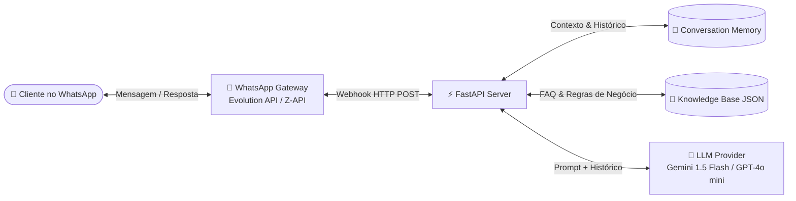

# 🤖 WhatsApp AI Chatbot

[](https://www.python.org/)
[](https://fastapi.tiangolo.com/)
[](https://ai.google.dev/)
[](https://openai.com/)
[](https://www.docker.com/)
[](LICENSE)

Backend inteligente para automação de atendimento e FAQ no WhatsApp utilizando **FastAPI** e modelos de linguagem de última geração (**Google Gemini** ou **OpenAI GPT-4o mini**).

Desenvolvido para atender clientes com respostas naturais, ágeis e contextualizadas com base nas regras e catálogo da empresa, com suporte nativo a transbordo para atendentes humanos.

---

## 🎯 Arquitetura da Solução



---

## ✨ Principais Funcionalidades

- **⚡ Alta Performance:** Construído sobre **FastAPI** assíncrono com processamento em segundo plano (`BackgroundTasks`).
- **🧠 IA com Base de Conhecimento Própria:** A IA responde estritamente de acordo com as informações cadastradas no arquivo `knowledge_base.json` (serviços, horários, preços, regras).
- **💬 Memória de Contexto:** O bot lembra das últimas interações do cliente para manter um diálogo natural.
- **👨‍💻 Transbordo Humano Inteligente:** Se o cliente pedir para falar com uma pessoa ou fizer uma pergunta crítica fora do escopo, o bot transfere o atendimento automaticamente.
- **🔌 Multi-Provedores:**
  - **IA:** Compatível com **Google Gemini** e **OpenAI**.
  - **WhatsApp:** Compatível com **Evolution API**, **Z-API** ou webhooks REST diretos.
- **🧪 Teste Fácil sem Celular:** Endpoint `/api/chat` e documentação interativa Swagger (`/docs`) para testar o cérebro da IA direto pelo navegador.

---

## 🚀 Como Executar o Projeto

### Pré-requisitos
- Python 3.11+ instalado (ou gerenciador `uv`)
- Chave de API da [Google AI Studio (Gemini)](https://aistudio.google.com/) ou [OpenAI](https://platform.openai.com/)

### 1. Clonar o Repositório
```bash
git clone https://github.com/LuanRoccha13/whatsapp-ai-chatbot.git
cd whatsapp-ai-chatbot
```

### 2. Configurar o Ambiente Virtual e Dependências

Com **uv** (rápido e recomendado):
```bash
uv venv
uv pip install -r requirements.txt
```

Ou com **pip**:
```bash
python -m venv .venv
source .venv/bin/activate  # No Windows: .venv\Scripts\activate
pip install -r requirements.txt
```

### 3. Configurar Variáveis de Ambiente
Copie o arquivo de exemplo e configure suas chaves:
```bash
cp .env.example .env
```
Edite o arquivo `.env`:
```env
AI_PROVIDER=gemini
GEMINI_API_KEY=sua_chave_do_google_ai_studio
```

### 4. Executar o Servidor
```bash
uvicorn app.main:app --reload --port 8000
```
O servidor estará rodando em: `http://localhost:8000`  
Acesse a documentação interativa da API em: **`http://localhost:8000/docs`**

---

## 📱 Conectando ao WhatsApp (Evolution API)

1. Suba uma instância da [Evolution API](https://github.com/EvolutionAPI/evolution-api) (via Docker ou Cloud).
2. Escaneie o QR Code com o número comercial do WhatsApp.
3. Configure o **Webhook** da instância para apontar para a sua URL pública:
   - **URL:** `https://seu-dominio.com/webhook`
   - **Eventos:** `MESSAGES_UPSERT`

> 💡 *Dica para testes locais:* Use o [ngrok](https://ngrok.com/) para expor sua porta 8000 na internet:
> ```bash
> ngrok http 8000
> ```

---

## 🧪 Como Testar sem WhatsApp Conectado

Você pode testar a IA diretamente enviando uma requisição HTTP para `/api/chat`:

```bash
curl -X POST "http://localhost:8000/api/chat" \
     -H "Content-Type: application/json" \
     -d '{
       "sender_phone": "5511999999999",
       "sender_name": "Cliente Teste",
       "message_text": "Olá! Gostaria de saber quais serviços vocês oferecem e o prazo de entrega."
     }'
```

---

## 📂 Personalizando a Base de Conhecimento

Para adaptar o bot para qualquer tipo de empresa (clínica médica, e-commerce, consultoria, restaurante):
1. Abra o arquivo `app/data/knowledge_base.json`.
2. Altere o nome da empresa, catálogo de serviços, horários de atendimento e perguntas frequentes.
3. O bot passará a responder imediatamente com as novas informações, sem necessidade de retreinamento de modelo.

---

## 🐳 Executando com Docker

```bash
docker compose up -d --build
```

---

## 🧪 Executando os Testes Automatizados

```bash
pytest
```

---

## 📄 Licença

Este projeto está licenciado sob a licença [MIT](LICENSE).

---

Desenvolvido por **[Luan Rocha da Silva](https://github.com/LuanRoccha13)** 👋
